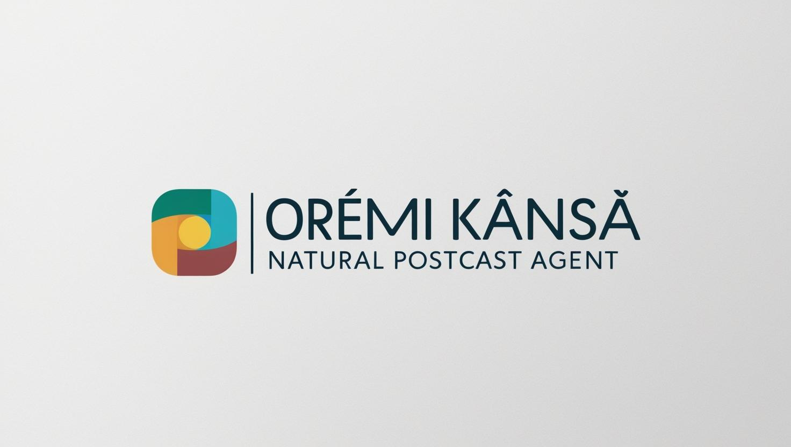

# Oremi Kànsà

**Oremi Kànsà** is an MCP server for discovering podcasts through the
Podcast Index. It provides AI assistants and autonomous agents with a
standardized interface to search, browse, and retrieve podcast information
using the Model Context Protocol (MCP).

Designed to run in Docker, Oremi Kànsà exposes tools for searching podcasts,
exploring episodes, browsing categories, and retrieving metadata from
Podcast Index. It enables MCP-compatible clients to access podcast content
without interacting directly with the Podcast Index API.

The name **Oremi Kànsà** comes from the Yoruba language. _Oremi_ means
_"my friend"_, reflecting the project's goal of building a helpful and
trustworthy AI ecosystem. _Kànsà_ is derived from the Yoruba word associated
with _broadcasting_ or _broadcast media_, representing the service's
responsibility for helping AI agents discover podcast content through a
unified MCP interface.

## Core Capabilities

- Search and discover podcasts by topic, language, and category
- Retrieve detailed podcast and episode metadata
- Browse categories, trending shows, and related podcasts
- Return structured, validated response models for MCP clients
- Query the offline Podcast Index SQLite catalog with structured models
- Accelerate searches with persistent FTS5 indexes and a bounded memory cache
- Persist and periodically refresh the catalog in `/oremi/data` in Docker
- Configure database updates, HTTP timeouts, HTTP binding, API prefix, and
  logging through environment variables
- Serve MCP over Streamable HTTP
- Run as a lightweight Docker container with simple deployment.
- Integrate seamlessly with the Oremi ecosystem and other MCP-compatible
  clients.

## Documentation

All project documentation—including architecture details, configuration
reference, and the Home Assistant integration guide—can be found at:
https://demsking.gitlab.io/oremi-kansa/

## Development

Oremi Device is built with Python and uses `uv` for dependency management. The
project follows standard Python development practices with type hints, linting,
and automated testing.

For detailed information on setting up your development environment, running
tests, code style guidelines, and the pull request process, please refer to
[CONTRIBUTING.md](https://gitlab.com/demsking/oremi-kansa/-/blob/main/CONTRIBUTING.md).

## Versioning

This project adheres to [Semantic Versioning](https://semver.org/) (SemVer).
Version numbers follow the `MAJOR.MINOR.PATCH` format:

- **MAJOR** version increments for incompatible API changes
- **MINOR** version increments for backward-compatible new functionality
- **PATCH** version increments for backward-compatible bug fixes

## License

Copyright 2026 Sébastien Demanou. All Rights Reserved.

Licensed under the Apache License, Version 2.0. See the
[LICENSE](https://gitlab.com/demsking/oremi-kansa/-/blob/main/LICENSE) for the
complete license text.
